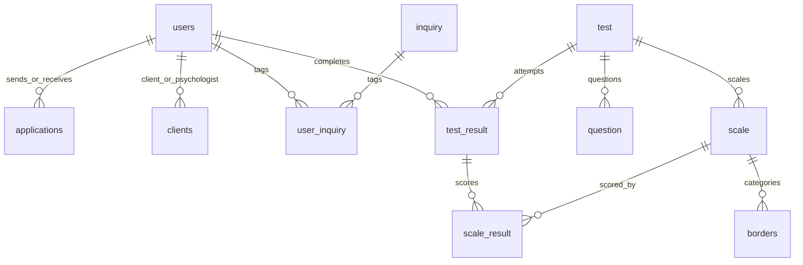

# Схема Compas

Таблицы: users, inquiry, user_inquiry, applications, clients, test, question, answer_choice, scale, borders, test_result, scale_result.

`question.answer_choice` содержит UUID вариантов из `answer_choice` в массиве PostgreSQL, как в исходном проекте. Это не FK-связь: целостность массива проверяется приложением и тестами каталога.

Порядок вопросов — `number`, порядок шкал — `position`. При первичном заполнении порядок шкал берётся из исходного `scale_info.json`, в котором расположены результаты соответствующих формул. ID исходных тестов, шкал, вопросов и вариантов сохранены.

Одна активная связь clients соответствует паре (client_id, mentor_id); уникальность пары обеспечена БД. Пара заявки (client_id, manager_id) тоже уникальна. Результаты многократных прохождений имеют разные test_result.id; их история не удаляется при группировке карточек.

Индексы начальной миграции покрывают поиск истории, шкал прохождения, клиентов психолога, входящих заявок и вопросов теста. Эффективность на больших данных необходимо замерять через EXPLAIN ANALYZE, а не выводить из наличия индекса.
